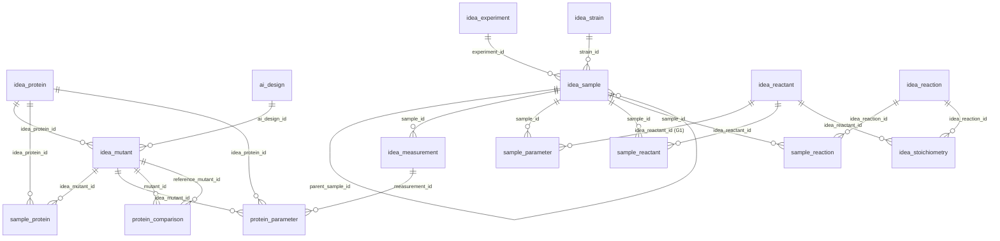

# IDEAS tenant — minimal typed schema design

**Arc:** ideas-datalake-development · **status:** draft for review · **date:** 2026-08-11

## Purpose
A tight, typed schema to be served in the IDEAS tenant on the lakehouse that houses **every data element the forthcoming IDEAS publication must expose** (AI-guided enzyme engineering — nylon/N66 activity + diad/triad/tetrad amide synthesis), reusing the **v9 prototype**.

## Inputs reviewed
- **Current IDEAS tenant** — 21 tables, 715 pilot rows; a raw Hive→Iceberg lift: **all 145 columns typed STRING**, relationships inferred from `_id` naming only, none enforced.
- **v9 prototype** (`idea_v9_demo.db`) — same entities, **natively typed** (INTEGER/REAL/BOOLEAN/DATE/DATETIME), audit columns, and two additions that matter: **`protein_comparison`** (fold-change vs a reference) and **`sample_parameter.value_type`**.
- **Paper data** — 4 workbooks / 12 sheets + manuscript/SI: titers (mg/L), mass-spec intensities, fold-change-to-WT, conversion %, per replicate; a 326-variant site-saturation panel; combinatorial mutants; plate positions; reaction conditions.

## What the analysis showed
1. **Coverage — zero orphans.** Every distinct paper element (entities E1–E9, measured quantities M1–M7, conditions C1–C7) maps to a home in a v9-derived schema. Full mapping: `build/COVERAGE_MATRIX.md`.
2. **v9 reuse is high (~90% as-is).** The one requirement that looked hardest — per-replicate **fold-change to WT** — is already met exactly by v9's new `protein_comparison` table (`value`, `reference_mutant_id`, `reference_measurement_id`).
3. **Edges are clean.** All 22 foreign-key relationships in the v9 data validate with **0 orphan child keys** — the relationship graph is sound to carry forward (unlike the tenant's unenforced inferred edges).
4. **The only structural decision is G1** (below); everything else is a minor convention.

## Design decisions

| id | decision | recommendation |
|---|---|---|
| **G1** | Per-analyte measurements (titer / mass-spec intensity / conversion %) are values *about a specific product in a specific sample*, but v9's `sample_parameter` is scoped to the sample only — multiple products in one well collide on `label`. | **Add a nullable `idea_reactant_id` (analyte/product) — and optional `idea_reaction_id` — to `sample_parameter`.** One FK column, keeps the EAV shape, disambiguates every product-scoped value. *(Applied in the DDL; your call to confirm.)* |
| G2 | Reaction conditions (time, temp) | Carry as `sample_parameter` rows (no schema change). Promote to `idea_experiment` columns only if you routinely filter by them. |
| G3 | Plate position (ROW/COL) | Keep in `sample.storage_location` (free text). Split into columns only if positional queries are needed. |
| G4 | Sample type (lysate/purified, "6,6") | Add a light `idea_sample.sample_type` column (applied) + `idea_experiment.type` for the polymer type. |
| WT flag | Fold-change needs an unambiguous baseline | Added `idea_mutant.is_wild_type BOOLEAN` so the reference variant is explicit, not string-matched. |

## The schema
- **22 tables, 223 columns**, fully typed. DDL: `build/ideas_min_schema.sql` (validated — loads clean). Types given in ANSI SQL with the Iceberg mapping noted in-file.
- **Grouping:** `[PAPER]` = required to serve the publication · `[INTEGRITY]` = relationship/provenance backbone · `[OPTIONAL]` = platform-valuable (ai_design, computation, idea_dbxref), retained for IDEAS' identity but not paper-required. If you want the strictly paper-minimal cut, drop the three `[OPTIONAL]` tables → **19 tables**.
- Every table keeps `created_at` / `updated_at` / `created_by`.

## Entity-relationship overview

## Migration note (current tenant → this schema)
1. **Type-cast on load.** The current tenant is all-STRING; the load must cast numerics to REAL, dates to DATE/DATETIME, flags to BOOLEAN. v9 already encodes the correct target types per column — use it as the casting spec.
2. **Reshape replicates wide→long.** Workbook "Replicate 1..N" columns become N `idea_sample` rows (one per `replicate`), each with its own `sample_parameter`/`protein_comparison` value. This is a load transform, not a schema change.
3. **Populate the G1 analyte FK** when loading product-scoped values (MAXA/XAMA/… titers, diad/triad/tetrad intensities) so each value names its product.
4. **Assert the FK edges at the app/load layer** — Iceberg won't enforce them; the validation script (`build/`, 0 orphans on v9) is the pattern to run against tenant loads.

## G1 — RESOLVED 2026-08-19

**Chris Henry confirmed: `sample_parameter` gets the analyte foreign key.** Adopt G1 as
written; no revert. The DDL already reflects it (`ideas_min_schema.sql` lines 163-164:
`idea_reactant_id`, plus the optional `idea_reaction_id`), so the schema needs no change —
this record exists so the decision is not re-litigated at load time.

Rationale recorded at decision time: this data is being **published** (Zenodo deposit
supporting JACS ja-2026-03464t), not only served internally. Without the FK, a well
reporting MAXA/XAMA/MAMA/XAXA values collides on `label` alone, and every downstream
consumer — including a reviewer opening the deposited CSV — must string-parse `label` to
learn which product a number describes. Machine-usability is most of the point of
depositing a relational schema rather than the original workbooks.

**Load consequence:** a null `idea_reactant_id` on a product-scoped row (titer, mass-spec
intensity, conversion %) is a defect, not a permitted absence. Count them; the count must
be zero.

---

## Original open item (superseded by the above)

**Confirm G1** (add the analyte FK to `sample_parameter`) — it's the one structural change and it's already reflected in the DDL. If you'd rather keep `sample_parameter` sample-only and encode the product in the `label` string, say so and I'll revert it.
